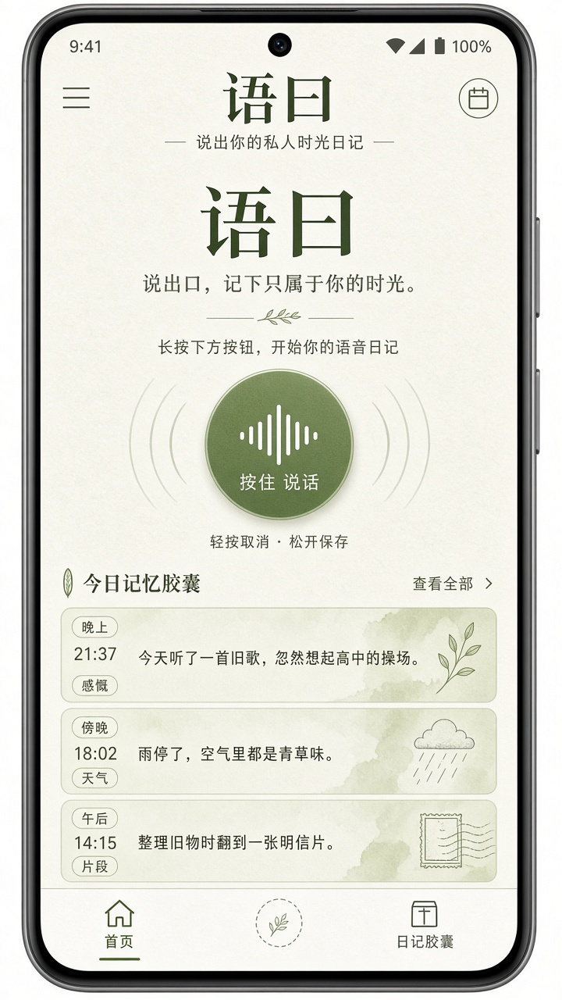
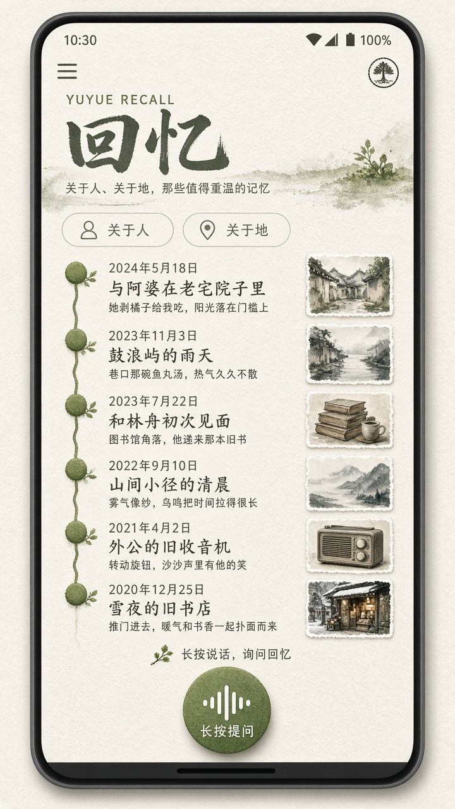
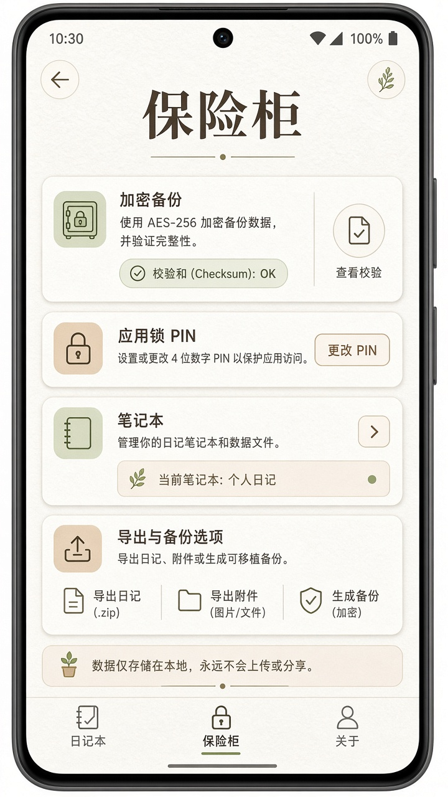

# 语曰 · Yuyue

<p align="center">
  
</p>

<p align="center">
  <strong>按住说一句，落到那一天。</strong><br/>
  用说话写的私人时间日记 — 本机优先，不是云笔记。
</p>

<p align="center">
  <a href="./README.md">English</a> · <a href="./README.zh-CN.md">中文</a>
</p>

<p align="center">
  
  
  
  
</p>

---

## 它是什么

**语曰**是一款 Android 应用：用说话写下私人时间日记。

| 主循环 | 含义 |
|--------|------|
| **记** | 按住说、打字、分享照片 — 原话先落本机 |
| **看** | 月历 → 当日胶囊 → 详情（模糊时间如「约晚上」） |
| **忆** | 语音/文字回忆 — 本机 FTS / 向量；命中可追溯到条目 ID |

AI 只做可选润色。**本机数据库与备份是权威**；模型失败不得误写或覆盖日记。

视觉品牌：**纸 · 墨 · 苔 · 陶**。

## 界面

| 首页 | 时间 | 回忆 | 保险柜 |
|------|------|------|--------|
| 语音球为主；今天与近期 | 记忆地图月历 | 日期节点回忆 | 锁、YUY2 备份、导出 |

可点原型：[`docs/rebuild/prototypes/index.html`](docs/rebuild/prototypes/index.html)

## 快速开始

### 环境

- Android Studio（JDK **17**）
- Android SDK **35**，设备/模拟器 **API 29+**
- 首次构建需联网下载 Vosk / BGE 模型（缓存于 `assets/`，已 gitignore）

### 1. 克隆

```bash
git clone https://github.com/XiaoYuTianTian/yuyue.git
cd yuyue
```

### 2. 配置密钥（模板必用）

```bash
cp config.local.properties.example config.local.properties
```

编辑 `config.local.properties`，把所有 `***` 换成你自己的值：

| 键 | 是否必须 | 用途 |
|----|----------|------|
| `LLM_API_KEY` | 可选 | MiniMax（或兼容 OpenAI）润色密钥 |
| `LLM_BASE_URL` | 可选 | 默认 `https://api.minimaxi.com` |
| `LLM_MODEL` | 可选 | 默认 `MiniMax-M2.7` |
| `SILICONFLOW_API_KEY` | 可选 | 快速提取；不填则跳过 |
| `JWT_SECRET` | 仅遗留 server | 开发用 |

> 密钥编译进 `BuildConfig`，**禁止提交**。  
> **无任何 API Key 也可离线记 / 看 / 本机忆。**

### 3. 打开并运行

1. Android Studio → **Open** 仓库根目录。
2. 运行配置选 **`android-app`**；QA 包选 build type **`qa`**（`com.yuyue.app.qa`）。
3. 装到模拟器或真机。首次会创建默认记事本。

```bash
.\gradlew.bat :android-app:installDebug
.\gradlew.bat :android-app:installQa
```

### 4. 冒烟验证

1. 按住苔色语音球 → 说话 → 预览确认 → **时间**页有标记。
2. 断网再记一条 → 原话仍保存。
3. **保险柜** → 设置备份口令 → 导出 YUY2 加密备份。

## 安全

1. 确认 `config.local.properties` **不在** git 中。
2. 凡在聊天/截图/旧 fork 出现过的 Key，请轮换。
3. 勿提交 `docs/testing/evidence/`（可能含个人日记样例）。

## 文档与变更

- 英文主页与完整链接见 [README.md](./README.md)
- 版本记录：[CHANGELOG.md](./CHANGELOG.md) — **每次有意义变更请追加条目**

## 许可

尚未附加开源许可证；在作者声明前视为 **保留所有权利**。商业使用请先联系。
