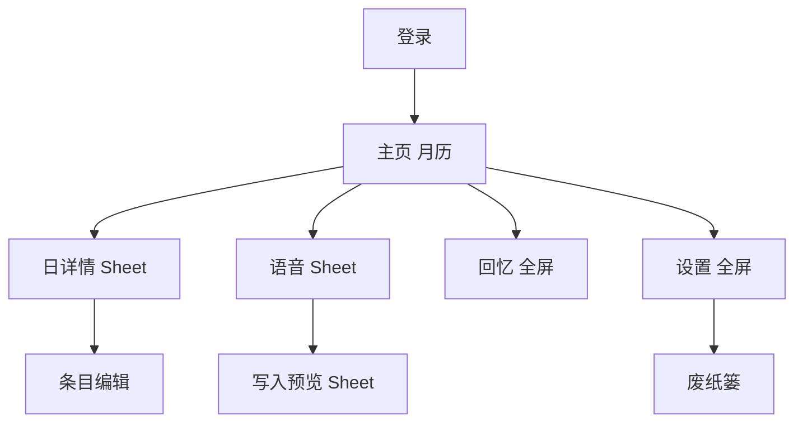

# 语曰（Yuyue）UI 原型与设计规范

> 苹果 Human Interface Guidelines 取向 + 保留「语曰」暖色品牌。  
> 高保真示意见 [docs/mockups/](mockups/) 目录。

---

## 1. 设计定位

| 项 | 决策 |
|----|------|
| 风格 | **iOS 布局与交互**（大标题、分段控件、Bottom Sheet、分组列表） |
| 色彩 | **保留奶油暖底** `#F5F0E8` + 鼠尾草绿 `#4A5D4E`（非系统灰 + 系统蓝） |
| 主操作 | 底部居中麦克风，长按录音，点按纯文本 |

---

## 2. Design Tokens

| Token | 值 | 用途 |
|-------|-----|------|
| `background` | `#F5F0E8` | 页面底 |
| `backgroundGrouped` | `#FFFFFF` | 卡片、Sheet、分组块 |
| `primary` | `#4A5D4E` | 强调、选中、麦克风 |
| `primaryMuted` | `#4A5D4E` @ 20% | 有记录日期底 |
| `secondary` | `#8B9D83` | 聆听中麦克风 |
| `onBackground` | `#2C332E` | 主文字 |
| `onSurfaceVariant` | `#6B7280` | 次要文字 |
| `separator` | `#E5E0D8` | 分割线 |
| `cornerCard` | 12dp | 卡片 |
| `cornerSheet` | 16dp | Sheet 顶角 |
| `titleLarge` | 34sp Bold | 大标题 |
| `titleMedium` | 20sp SemiBold | 区块标题 |
| `body` | 17sp Regular | 正文 |
| `caption` | 13sp Regular | 辅助 |

---

## 3. 信息架构



---

## 4. 线框：登录

```
┌─────────────────────────┐
│                         │
│      语曰               │  ← titleLarge
│   那时的想法，说出口     │
│                         │
│  ┌───────────────────┐  │
│  │ 手机号             │  │  分组圆角输入
│  └───────────────────┘  │
│  ┌───────────────────┐  │
│  │ 验证码             │  │
│  └───────────────────┘  │
│                         │
│  [ 获取验证码 ]  [ 登录 ] │
└─────────────────────────┘
```

---

## 5. 线框：主页

```
┌─────────────────────────┐
│ 语曰              🔍 ⚙  │  ← Large title 区 + 图标
│ 生活记事本               │  ← 副标题
├─────────────────────────┤
│ [ 生活 │ 工作 ]          │  ← 分段控件 + 色点
├─────────────────────────┤
│      ‹  2026年5月  ›     │
│ 日 一 二 三 四 五 六      │
│ ┌─日历网格────────────┐  │
│ │  ●今日环  ·有记录点  │  │
│ └─────────────────────┘  │
│                         │
│      ╭─────────╮        │
│      │  🎤    │        │  ← 毛玻璃底栏 + 麦克风
│      ╰─────────╯        │
│    长按说话 · 点按文字    │
└─────────────────────────┘
```

---

## 6. 线框：日详情 Sheet

```
┌─────────────────────────┐
│        ───              │  drag handle
│  5月18日 星期六          │
├─────────────────────────┤
│  09:00  会议记录         │
│         与客户讨论…      │  ← 左滑删除
│  15:30  外卖午餐         │
├─────────────────────────┤
│  + 添加文字记录          │
└─────────────────────────┘
```

---

## 7. 线框：语音 / 回忆 / 设置

- **语音 Sheet**：波形占位、实时转写、提交按钮（主色填充）
- **写入预览 Sheet**：多条可勾选卡片，时间可编辑
- **回忆全屏**：搜索框 + AI 总结 + 时间线分组列表
- **设置全屏**：分组列表（账号、导出、废纸篓、关于）
- **废纸篓**：条目列表 + 恢复

---

## 8. 现 UI 与目标差距对照

| 模块 | 改版前 | 改版后（本迭代目标） |
|------|--------|---------------------|
| 顶栏 | Material TopAppBar | 大标题 + 副标题 |
| 记事本 | ScrollableTabRow | 分段控件 + 色点 |
| 月历 | 无星期/今日 | 星期行 + 今日环 + 选中态 |
| 语音/回忆/设置 | AlertDialog | Sheet / 全屏页 |
| 底栏麦克风 | 纯色 Surface | 半透明底栏 + 脉冲动画 |
| ingest | 仅确认文案 | 预览列表可勾选 |
| 回忆 | Dialog 列表 | 时间线 + 总结 |
| 条目 | 仅删除按钮 | 左滑删除 + 编辑页 |
| 设置 | Dialog | 独立页 + 废纸篓入口 |

---

## 9. 组件清单（Compose）

| 组件 | 文件 |
|------|------|
| `YuyueTheme` | `ui/theme/Theme.kt` |
| `LoginScreen` | `ui/LoginScreen.kt` |
| `HomeScreen` | `ui/HomeScreen.kt` |
| `NotebookSegmentedControl` | `ui/components/NotebookSegments.kt` |
| `IosStyleCalendar` | `ui/components/CalendarGrid.kt` |
| `VoiceOrbBar` | `ui/components/VoiceOrb.kt` |
| `DayDetailSheet` | `ui/components/DaySheet.kt` |
| `VoiceInputSheet` | `ui/components/VoiceSheet.kt` |
| `RecallScreen` | `ui/RecallScreen.kt` |
| `SettingsScreen` | `ui/SettingsScreen.kt` |
| `TrashScreen` | `ui/TrashScreen.kt` |
| `IngestPreviewSheet` | `ui/components/IngestPreviewSheet.kt` |
| `EntryEditScreen` | `ui/EntryEditScreen.kt` |
