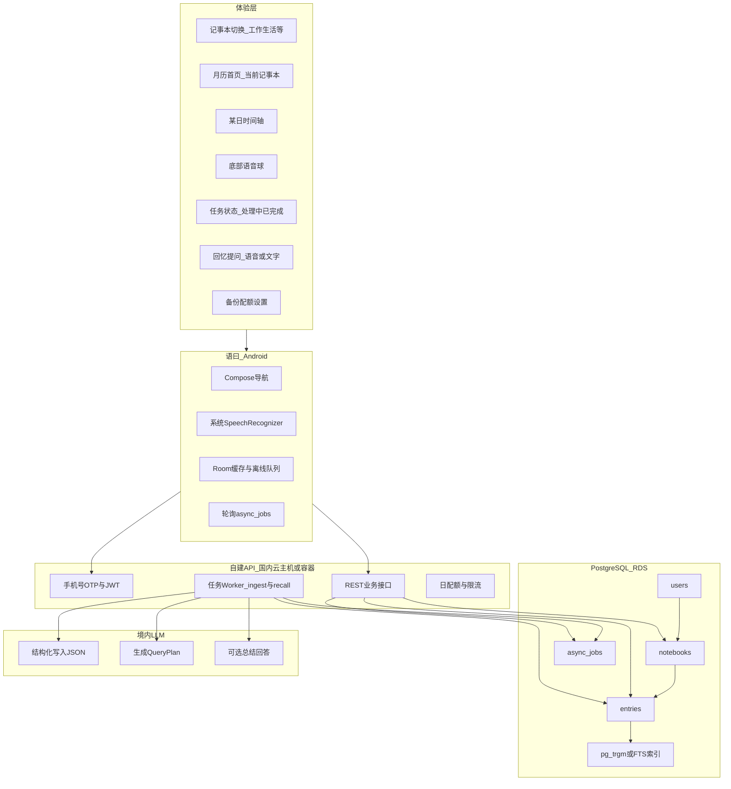
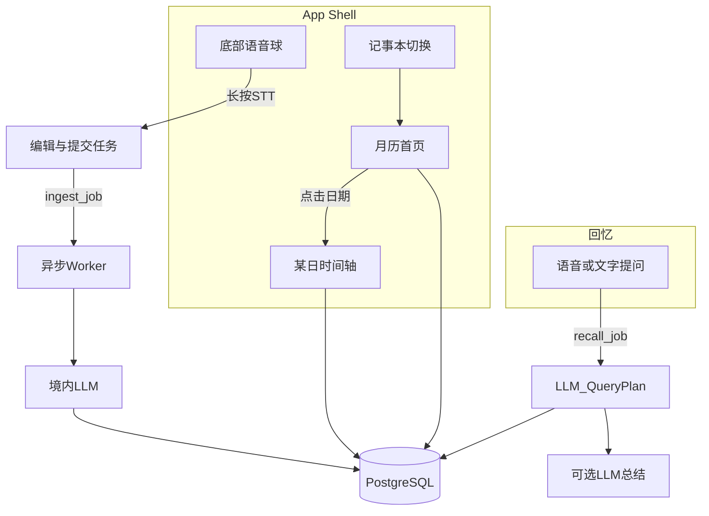
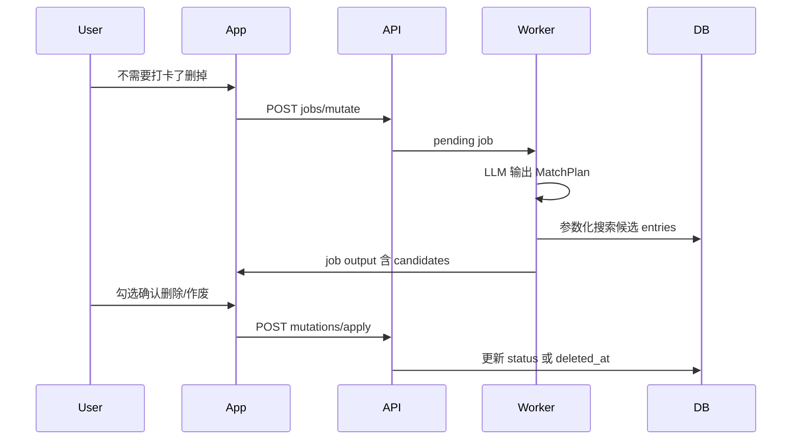
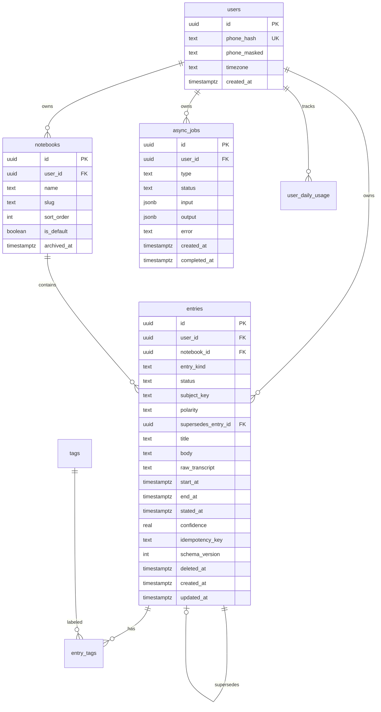
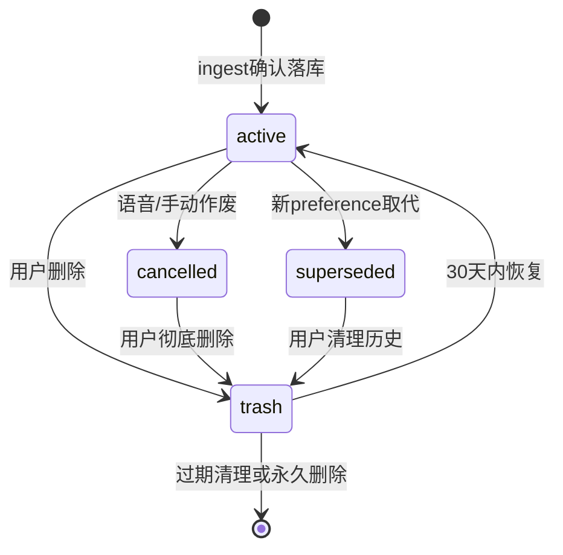

> 项目内方案副本（与 Cursor 计划同步，请勿在此替代 IDE 内计划编辑）。
> 同步日期：2026-05-18


# 语曰（Yuyue）：语音日历记事 — 产品与技术方案

## 应用定名

- **中文名**：语曰  
- **英文名（侧载包/关于页）**：Yuyue  
- **一句话**：那时的想法，说出口，就留在时间里。（「语」为口述，「曰」为记下；类「子曰」，却是你自己的话。）  
- **分发说明示例**：语音日历记事 · 按时刻记录、按时间回忆

---

## 已定决议（锁定，2026-05）


| 编号  | 你的选择   | 落地含义                                                                          |
| --- | ------ | ----------------------------------------------------------------------------- |
| Q1  | **C**  | **自建轻后端 API** + **国内托管 PostgreSQL**（如阿里云 RDS / 腾讯云 PostgreSQL）；数据与推理接口自控、境内驻留 |
| Q2  | **B**  | **手机号 + 短信验证码** 注册/登录（需短信资质与防刷）                                               |
| Q3  | **A**  | **仅系统 `SpeechRecognizer`** 流式转写，不上传音频做云端 STT                                  |
| Q4  | **A**  | **境内商用大模型 API**（通义 / DeepSeek / 智谱等），Key 仅存服务端                                |
| Q5  | **B**  | **写入与回忆均走异步任务**（`async_jobs` 表 + 轮询；推送可后置）                                    |
| Q6  | **定制** | 用户自然语言 → **LLM 生成检索计划**（时间范围、记事本、关键词、检索方式）→ 服务端执行 SQL/FTS → 再可选 LLM 组织回答      |
| Q7  | **A**  | **不存原始录音**，仅存文本与结构化字段                                                         |
| Q8  | **A**  | 多设备 **Last-Write-Wins**（`updated_at` 大者胜）                                     |
| Q9  | **B**  | **开放注册** + **按用户日限流**（LLM / 提交次数）                                             |
| Q10 | **A**  | **侧载 / 酷安等**，暂不走主流商店与 ICP 全套                                                  |


**附（实现前定口径，沿用原建议）**：最低 Android **10+**；首版仅 Android；无 GMS 机型需单独测系统 STT。

---

## 〇、产品架构（逻辑分层）

从「用户能感知的功能」到「外部依赖」，自上而下分为 **体验层 → 客户端域 → 自建 API → 国内 PostgreSQL → 境内 LLM**。所有业务表以 `**user_id` 为租户根**；内容以 `**notebook_id` 分类**；时刻以 `**entries.start_at`（UTC）** 驱动日历。




**数据流摘要**

1. **写入（Q5B）**：`VoiceOrb` → `STT` → 用户编辑确认 → `POST /jobs/ingest`（含 `notebook_id`、`text`、`client_now`）→ 返回 `job_id` → Worker 调 `LLMIngest` → 校验 JSON → 写入 `entries` → 客户端 `JobPoller` 完成后刷新月历/日轴。
2. **读日历**：`GET /entries?notebook_id=&day=`，服务端强制 `WHERE user_id = :jwt_uid`；`start_at` 存 UTC，展示按用户时区。
3. **回忆（Q6 定制）**：用户问句 → `POST /jobs/recall` → Worker 调 `LLMPlan` 得 **QueryPlan**（时间范围、记事本、关键词、检索模式）→ 服务端执行 **参数化 SQL + FTS**（禁止 LLM 直接拼 SQL）→ 命中 `entries` → 可选 `LLMAnswer` 生成自然语言答复 → 客户端展示条目列表 + 总结。

---

## 一、产品形态与信息架构




- **记事本（分类）**：顶部或侧栏切换 **工作 / 生活 / 自定义** 等；月历、日轴、写入、回忆默认作用于 **当前记事本**；支持「全部记事本」只读汇总视图（可选，MVP 可只做单本切换）。
- **默认首页**：当前记事本的月历；有记录的日期打点。
- **某日视图**：纵向时间轴展示 `entries`；**长按条目** → 编辑 / 删除 / 作废；`cancelled` 显示删除线或折叠。
- **底部语音球**：长按录入；语义含「删掉」「不用了」→ 走 **mutate** 任务，展示候选后确认。
- **废纸篓**：设置内 30 天可恢复；永久删除需二次确认。
- **回忆**：返回 **时间线卡片**（同 `subject_key` 聚合）+ 自然语言总结；「当前」与「历史上某刻」由 QueryPlan 的 `temporal_scope` 区分。

---

## 二、核心流程（与你的 3 条需求对齐）

### 1）长按语音 → 实时转写 → 限 1 分钟（Q3A）

- **采集**：仅 **系统 `SpeechRecognizer`**，partial results 实时刷新；不依赖 Google 账号与云端 STT。
- **硬限制**：最长 **60s** 自动结束。
- **编辑**：转写可改；提交时携带 `**notebook_id`**（当前记事本）与 `**client_now`（含时区）**。

### 2）异步写入：结构化日历记录（Q4A + Q5B）

- **客户端**：`POST /v1/jobs/ingest`，body 含 `idempotency_key`、`notebook_id`、`raw_transcript`、`client_now`、`locale`。
- **Worker**：调境内 LLM，输出 **严格 JSON**（`response_format` / JSON Schema），解析后写入 `entries`；失败写 `async_jobs.error`。
- **ingest 输出示例**（可一次生成多条 `entries`）：

```json
{
  "intent": "create",
  "entries": [
    {
      "entry_kind": "event",
      "title": "外卖午餐",
      "body": "去年九月某日午后点了外卖，路过觉得好吃",
      "subject_key": "food/takeout",
      "start_at": "2024-09-15T15:00:00+08:00",
      "stated_at": "2026-05-18T10:00:00+08:00",
      "confidence": 0.78,
      "source_quote": "去年九月下午三点…"
    },
    {
      "entry_kind": "preference",
      "title": "不喜欢水果",
      "body": "用户表示今年起不喜欢吃水果",
      "subject_key": "food/fruit",
      "polarity": "negative",
      "start_at": "2026-05-18T09:00:00+08:00",
      "stated_at": "2026-05-18T09:00:00+08:00",
      "supersedes_match": { "subject_key": "food/fruit", "polarity": "positive" }
    }
  ]
}
```

- **supersedes_match**：ingest Worker 在落库前按条件查找旧 `preference`，命中则设旧条 `status=superseded` 并写入新条 `supersedes_entry_id`（**须用户预览确认**）。
- **用户确认**：异步完成后进入 **预览页**（可改时间/记事本/勾选条目），确认后再 `PATCH` 正式落库（或 ingest 直接落库 + 允许事后编辑，二选一；**建议预览后落库** 以减少错时间写入）。
- **幂等**：`(user_id, idempotency_key)` 唯一，防弱网重复提交。

### 3）回忆检索：LLM 编排查询计划（Q6 定制）

- **客户端**：`POST /v1/jobs/recall`，body 含 `query_text`、`client_now`、可选 `notebook_id`（仅作默认提示，LLM 可改）、`locale`。
- **第一步 LLM（QueryPlanner）**：输入用户问句 + **该用户记事本列表**（id、name、slug）+ `client_now`，输出 **QueryPlan JSON**（禁止 SQL 文本）：

```json
{
  "notebook_ids": ["uuid-life"],
  "temporal_scope": "explicit_range",
  "time_range": {
    "start_at": "2024-09-01T00:00:00+08:00",
    "end_at": "2024-09-30T23:59:59+08:00"
  },
  "subject_keys": ["food/fruit"],
  "keywords": ["水果", "喜欢"],
  "entry_kinds": ["preference", "note"],
  "status_filter": ["active", "superseded"],
  "include_superseded": true,
  "group_by_subject": true,
  "search_mode": "fts",
  "sort": "stated_at_asc",
  "limit": 30
}
```

`**temporal_scope` 枚举（QueryPlanner 必选一）**


| 值                | 适用问法             | 检索与回答策略                                                                     |
| ---------------- | ---------------- | --------------------------------------------------------------------------- |
| `as_of_now`      | 「我现在喜不喜欢水果」      | 按 `subject_key` 分组，取 **stated_at 最新** 的 `active` preference；忽略 `superseded` |
| `explicit_range` | 「去年九月外卖」「去年喜不喜欢」 | 严格 `time_range` + FTS；时间线 **升序** 展示                                         |
| `all_time`       | 「我关于水果都说过什么」     | 同一 `subject_key` 拉全时间线，**包含 superseded**，Answerer 按时间叙述演变                   |


- **服务端执行**：预编译 SQL + 绑定参数；支持 `subject_key` 精确匹配与 `keywords` FTS 组合；**禁止 LLM 拼 SQL**。
- **Answerer 规则（写进 Prompt）**：
  - 存在 **同一 subject_key 下 polarity 相反** 的多条时，**必须按时间线说明**，不可只答最新一条（除非 `temporal_scope=as_of_now`）。
  - `as_of_now` 时只给 **当前结论**，可附一句「曾在 YYYY-MM 说过相反看法」并附 `entry_id`。
  - 每条引用标注 **记事本名称 + stated_at**，便于用户点进原文。
- **外卖例子**：`explicit_range` + keywords；**水果喜好**：`subject_key` + `group_by_subject` + 时间线。

### 4）日历展示

- 按 `**user_id` + `notebook_id` + 日区间`** 查` entries`；默认` status = active`且`deleted_at IS NULL`。

### 5）纠错：修改 / 删除 / 作废（语音 + 手动）

用户会说「不需要打卡了，把打卡记录删掉」——这类属于 **变更意图**，不能只靠新增 `entries`。

- **手动**：日时间轴 / 详情页 → **编辑**（PATCH）或 **删除**（软删进废纸篓，可恢复）。
- **语音变更**：`POST /v1/jobs/mutate`，由 LLM 判定 `action`：
  - `create` — 与 ingest 相同（也可统一进 ingest，见下）
  - `update` — 改标题/正文/时间/记事本
  - `cancel` — 将条目标为 **作废**（如「取消打卡提醒」），日历上可隐藏或显示删除线
  - `delete` — **软删除**（进废纸篓）
  - `supersede` — 新陈述 **取代** 旧陈述（见 3.9，用于喜好变化）

**mutate 流程（异步，同 Q5B）**：




- **MatchPlan 示例**（LLM 只输出匹配条件，不输出 SQL）：

```json
{
  "action": "delete",
  "match": {
    "keywords": ["打卡"],
    "notebook_ids": ["uuid-work"],
    "time_range": { "start_at": "2026-05-18T00:00:00+08:00", "end_at": "2026-05-18T23:59:59+08:00" },
    "entry_kinds": ["task", "reminder"]
  },
  "reason": "用户表示不再需要打卡"
}
```

- **安全**：`action=delete|cancel|supersede` 时，**默认必须用户确认**（候选 1 条且 confidence≥0.9 可设「一键确认」开关）；禁止 LLM 直接删库。
- **ingest 与 mutate 合并（实现建议）**：首版可只暴露 `POST /jobs/ingest`，LLM 先输出顶层 `intent: create|mutate`；mutate 时走同一 Worker 的 MatchPlan 分支，减少接口数量。

### 6）回忆：时间线 + 矛盾陈述（见 3.9）

- 问「我现在喜不喜欢水果」→ QueryPlan 设 `temporal_scope: as_of_now`，Answerer **以最近一条有效 preference 为准**，并注明时间。
- 问「我去年喜不喜欢」→ `temporal_scope: range(去年)`，**按时间线列出**，不强行合并矛盾。

---

## 三、数据模型设计（多租户 · 按时间 · 多记事本）

### 3.1 设计原则

- **租户根**：所有业务行带 `user_id`；API 从 JWT 取 `uid`，**每条 SQL 必须带 `user_id = :uid`**（应用层强制，等价于 RLS）。
- **分类维**：`notebooks` 表示「工作记事本 / 生活记事本」等；`entries` 必属某一 `notebook_id`。
- **时间维**：`entries.start_at` / `end_at` 为 `timestamptz`（UTC）；日历、QueryPlan 均基于此。
- **可改可删**：条目不是「只增不改」；支持 PATCH、软删除、废纸篓恢复；语音走 **mutate 任务 + 用户确认**。
- **软删除**：`entries.deleted_at` 表示进 **废纸篓**（默认保留 30 天可恢复，与导出备份一致）；`notebooks.archived_at` 仅归档分类。
- **状态机**：`entries.status` 区分 **有效 / 作废 / 已被取代**（见下），避免错误数据长期以「有效」参与检索。
- **同步冲突**：`entries.updated_at` LWW（Q8A）；mutate/delete 同样带 `updated_at` 校验。

### 3.2 ER 关系




### 3.3 表结构（PostgreSQL）

**users**


| 列                       | 类型          | 说明                 |
| ----------------------- | ----------- | ------------------ |
| id                      | uuid PK     | 用户 ID              |
| phone_hash              | text UNIQUE | 手机号哈希（不存明文）        |
| phone_masked            | text        | 如 `138****8000`    |
| timezone                | text        | 默认 `Asia/Shanghai` |
| created_at / updated_at | timestamptz |                    |


**notebooks**（分类 / 记事本）


| 列                       | 类型              | 说明                                          |
| ----------------------- | --------------- | ------------------------------------------- |
| id                      | uuid PK         |                                             |
| user_id                 | uuid FK → users | 租户                                          |
| name                    | text            | 展示名：「工作」「生活」                                |
| slug                    | text            | 程序用：`work`、`life`；**UNIQUE(user_id, slug)** |
| color                   | text            | 可选 UI 色                                     |
| icon                    | text            | 可选图标 key                                    |
| sort_order              | int             | 排序                                          |
| is_default              | boolean         | 新记录默认记事本（每用户至多一个 true）                      |
| archived_at             | timestamptz     | 归档后不在切换列表显示                                 |
| created_at / updated_at | timestamptz     |                                             |


- **注册种子数据**：自动创建 `生活`（slug `life`，default）、`工作`（slug `work`）；用户可再建「旅行」「健康」等。

**entries**（核心：按时刻存储的一条记忆；**可修改、可删除、可被新陈述取代**）


| 列                       | 类型                   | 说明                                                                |
| ----------------------- | -------------------- | ----------------------------------------------------------------- |
| id                      | uuid PK              |                                                                   |
| user_id                 | uuid FK              | 租户                                                                |
| notebook_id             | uuid FK → notebooks  | 分类（工作/生活等）                                                        |
| **entry_kind**          | text                 | `event` 事件 · `task` 待办/打卡 · `preference` 喜好/观点 · `note` 一般笔记      |
| **status**              | text                 | `active` 有效 · `cancelled` 已作废（如取消打卡）· `superseded` 已被新条取代         |
| **subject_key**         | text                 | 归一化主题，供关联与时间线，如 `food/fruit`、`habit/checkin`（LLM 填，便于「水果」类检索）     |
| **polarity**            | text                 | 可选：`positive` / `negative` / `neutral`（喜好类用，如喜欢/不喜欢水果）            |
| **supersedes_entry_id** | uuid FK → entries    | 当「今年不喜欢水果」取代「去年喜欢」时指向旧条                                           |
| title                   | text                 | 短标题                                                               |
| body                    | text                 | 整理后叙述                                                             |
| raw_transcript          | text                 | 用户原话                                                              |
| start_at                | timestamptz NOT NULL | **日历展示时间**（事件/陈述发生或生效时间，UTC）                                      |
| end_at                  | timestamptz          | 可空                                                                |
| **stated_at**           | timestamptz          | **用户说出这句话的时间**（默认=ingest 时 `client_now`；与 start_at 可不同，用于「去年说的」）  |
| confidence              | real                 | 时间推断置信度                                                           |
| source_quote            | text                 | 原话片段                                                              |
| schema_version          | int                  | 默认 1                                                              |
| idempotency_key         | text                 | 幂等                                                                |
| deleted_at              | timestamptz          | 软删除（废纸篓）；与 `cancelled` 二选一或组合使用（建议：用户删→deleted_at；语义取消→cancelled） |
| created_at / updated_at | timestamptz          | LWW                                                               |


**entry_kind 与 status 组合（检索默认过滤）**


| 场景         | entry_kind | status     | deleted_at                       |
| ---------- | ---------- | ---------- | -------------------------------- |
| 正常打卡提醒     | task       | active     | null                             |
| 「不用打卡了」    | task       | cancelled  | null                             |
| 用户要求删掉错误记录 | any        | any        | 非 null（废纸篓）                      |
| 今年不喜欢水果（新） | preference | active     | null                             |
| 去年喜欢苹果（旧）  | preference | superseded | null；`supersedes_entry_id` 由新条指向 |


**默认检索/日历**：`deleted_at IS NULL` AND `status IN ('active')`；「显示已作废」为设置项；「时间线回忆」可 `include_superseded=true`。

**tags** + **entry_tags**（可选，MVP 后可加）

| tags | user_id, name | UNIQUE(user_id, name) |
| entry_tags | entry_id, tag_id | 多对多，便于「外卖」「会议」横切 |

**async_jobs**（Q5B 统一任务表）


| 列                         | 类型          | 说明                                                                  |
| ------------------------- | ----------- | ------------------------------------------------------------------- |
| id                        | uuid PK     | 返回给客户端轮询                                                            |
| user_id                   | uuid FK     |                                                                     |
| type                      | text        | `ingest`                                                            |
| status                    | text        | `pending`                                                           |
| input                     | jsonb       | 请求体快照                                                               |
| output                    | jsonb       | ingest 预览 / recall 的 QueryPlan+hits / mutate 的 MatchPlan+candidates |
| error                     | text        | 失败原因                                                                |
| created_at / completed_at | timestamptz |                                                                     |


**user_daily_usage**（Q9B 限流）


| 列                                      | 说明    |
| -------------------------------------- | ----- |
| user_id, usage_date                    | PK 复合 |
| ingest_count, recall_count, llm_tokens | 当日累计  |


**sms_otp**（Q2B）

| phone_hash, code_hash, expires_at, attempt_count | 短期有效；防刷 |

### 3.4 索引（性能关键）

```sql
-- 日历：某用户某记事本某日
CREATE INDEX idx_entries_cal ON entries (user_id, notebook_id, start_at)
  WHERE deleted_at IS NULL;

-- 回忆：时间范围扫描
CREATE INDEX idx_entries_time ON entries (user_id, start_at DESC)
  WHERE deleted_at IS NULL;

-- 主题时间线（矛盾陈述、喜好演变）
CREATE INDEX idx_entries_subject ON entries (user_id, subject_key, stated_at DESC)
  WHERE deleted_at IS NULL;

-- FTS（Q6 执行层）
CREATE INDEX idx_entries_fts ON entries
  USING gin (to_tsvector('simple', coalesce(title,'') || ' ' || coalesce(body,'') || ' ' || coalesce(raw_transcript,'')));
```

（中文更好效果可后续换 `zhparser` 或 `pg_trgm` on `body`。）

### 3.5 API 与数据访问约定


| 方法     | 路径                      | 说明                                 |
| ------ | ----------------------- | ---------------------------------- |
| POST   | /v1/auth/sms/send       | 发短信（限流 IP+手机号）                     |
| POST   | /v1/auth/sms/verify     | 换 JWT                              |
| GET    | /v1/notebooks           | 列表（不含 archived）                    |
| POST   | /v1/notebooks           | 新建分类                               |
| PATCH  | /v1/notebooks/:id       | 改名/排序/归档                           |
| GET    | /v1/entries             | `notebook_id`, `day` 或 `from`/`to` |
| GET    | /v1/entries/:id         | 详情                                 |
| PATCH  | /v1/entries/:id         | 编辑（带 `updated_at` LWW）             |
| DELETE | /v1/entries/:id         | 软删除（进废纸篓）                          |
| POST   | /v1/entries/:id/restore | 从废纸篓恢复                             |
| POST   | /v1/jobs/ingest         | 创建 ingest 任务（含 intent=create）      |
| POST   | /v1/jobs/mutate         | 创建 mutate 任务（删/改/作废/取代）            |
| POST   | /v1/jobs/recall         | 创建 recall 任务                       |
| POST   | /v1/mutations/apply     | 用户对 mutate 候选确认后批量执行               |
| GET    | /v1/jobs/:id            | 轮询状态与 output                       |
| GET    | /v1/trash               | 废纸篓列表                              |
| POST   | /v1/export              | 触发全量导出 JSON（或客户端拉分页）               |


### 3.6 客户端 Room 镜像（离线）

- 表结构与云端对齐：`notebooks`、`entries`、`pending_jobs`（本地队列）。
- 同步策略：按 `notebook_id + day` 增量拉取；`updated_at` 大于本地水位则更新。

### 3.8 条目生命周期（纠错与废纸篓）




- **修改**：任意 `active` 条可 PATCH（改 time、body、notebook、kind）；修改后 `updated_at` 更新，LWW 同步。
- **删除**：默认 **软删**（`deleted_at`），日历与默认回忆不可见；设置 → **废纸篓** 可恢复。
- **作废 vs 删除**：「不用打卡了」优先 `status=cancelled`（保留痕迹，避免误删）；用户明确说「删掉」「移除记录」→ `deleted_at` 或 mutate `delete`。
- **审计（可选）**：`entry_audit_log(entry_id, action, snapshot, at)` 表 MVP 可不做，靠 `updated_at` + 导出备份兜底。

### 3.9 时间维度的矛盾陈述（设计要点）

**不要把矛盾合并成一条**，而是 **多条 entry + 关联**：


| 用户说法      | 落库策略                                                                        |
| --------- | --------------------------------------------------------------------------- |
| 去年：喜欢吃苹果  | `preference`, `polarity=positive`, `subject_key=food/fruit`, `stated_at≈去年` |
| 今年：不喜欢吃水果 | 新条 `polarity=negative`；旧条 `superseded` + `supersedes_entry_id` 指向旧条         |
| 早上要打卡     | `task`, `active`, `subject_key=habit/checkin`                               |
| 不用打卡了     | mutate → `cancel` 或 `delete` 匹配条；优先 `cancelled`                             |


**关联维度（回忆时由 QueryPlan 组合）**

1. **时间**：`stated_at` / `start_at` / `time_range`
2. **类别**：`notebook_id`（工作 vs 生活）
3. **主题**：`subject_key`（同主题拉时间线）
4. **类型**：`entry_kind`（只要喜好不要事件）
5. **状态**：默认仅 `active`；「我以前说过什么」才 `include_superseded`

**为何不只用向量相似度**：「喜欢苹果」与「不喜欢水果」语义相近但 **_polarity 相反**；必须靠 **subject_key + polarity + stated_at 排序** 与 Answerer 时间线规则，避免混成一条错误记忆。

**后续增强（非 MVP）**：`entry_links(link_type: contradicts|relates)` 表，由 LLM 在 ingest 时建议链接，用户可忽略。

### 3.10 导出备份 JSON 格式（版本 1）

```json
{
  "export_version": 1,
  "exported_at": "2026-05-18T12:00:00+08:00",
  "user_id": "uuid",
  "notebooks": [],
  "entries": [],
  "tags": []
}
```

---

## 四、后端部署形态（Q1C）与国内前提

- **API**：Kotlin **Ktor** / Java **Spring Boot** / Go 任选，部署在 **国内云轻量应用服务器或容器**（与 RDS 同地域）。
- **数据库**：**PostgreSQL 14+**（阿里云 RDS / 腾讯云），开启 **自动备份 + PITR**。
- **Worker**：与 API 同进程或独立 worker 容器，轮询 `async_jobs WHERE status='pending'`（`FOR UPDATE SKIP LOCKED`）。
- **LLM**：仅 Worker 调用境内 API；**日志脱敏**，不落完整 `raw_transcript` 到日志。
- **登录（Q2B）**：阿里云/腾讯云 **短信服务**；验证码 6 位、5 分钟有效、单号日上限。
- **分发（Q10A）**：APK 侧载；任务完成用 **应用内轮询**（推送后置）。
- **不依赖谷歌**：无 Google 登录、无 Drive；备份走 **SAF 本地/厂商网盘目录**。
- **开放注册（Q9B）**：`user_daily_usage` 限制如：ingest 50 次/日、recall 30 次/日、LLM token 上限（可配置）。

---

## 五、“数据永远不能丢失”：工程现实与分层策略

云端厂商也无法法律上承诺 100% 不丢，但可通过 **多层冗余** 接近“个人可接受的不丢”：

1. **云数据库层**：开启 **自动每日备份 + PITR**（付费能力）；多可用区由云厂商提供。
2. **应用内“用户可控备份”**（强烈建议 MVP 就做）：
  - **一键导出**：加密 JSON/ZIP（含所有事件）到 **本机**；通过 Android **[SAF](https://developer.android.com/guide/topics/providers/document-provider)** 让用户选择目录（可落在 **厂商网盘同步文件夹、电脑映射盘** 等），**不依赖 Google Drive/OneDrive 作为唯一出口**。
  - **可选**：同一文件 E2E 加密（用户口令派生密钥），云端只存密文。
3. **写入路径**：先 **本地 Room 队列**（离线可用）→ 成功同步后再标记已上传，避免网络抖动丢提交。
4. **原声（Q7A）**：不存录音；仅文本字段参与备份与 FTS。

---

## 六、Android 技术栈建议（实现落地时）

- **语言/UI**：Kotlin + Jetpack Compose + Navigation。
- **本地**：Room（`notebooks` / `entries` / `pending_jobs` 镜像与离线队列）。
- **网络**：Retrofit / Ktor Client 调自建 REST；JWT 存 EncryptedSharedPreferences。
- **日历 UI**：`HorizontalPager` 月切换 + `LazyColumn` 日时间轴；或成熟日历组件二次封装。
- **权限**：`RECORD_AUDIO`；Android 13+ 通知权限若需要后台提醒。

---

## 七、隐私、合规与成本提示（简）

- **隐私政策**：录音、云端转写、LLM、第三方 BaaS 需披露。
- **LLM 与 STT**：若走云端，默认视为 **可出境数据处理**；敏感用户可后续加“仅本地 STT + 不上传原文”开关（功能会弱）。
- **计费**：LLM 与 embedding 按 token；STT 若全走云端会增本；**设备端 STT + 仅文本上云** 通常更省。

---

## 八、易遗漏但会波及功能的设计要点（建议写进 PRD / 技术说明）

以下项若不提前定规则，往往在联调或用户真实场景里才爆炸，建议与 MVP 并行做“最低限度决策”，避免返工。

### 1）时间与日历（直接影响“点某天看时刻”是否正确）

- **时区与旅行**：所有 `start_at`/`end_at` 存 **UTC**；展示用 **用户当前系统时区** 或设置里可选“固定家乡时区”。否则跨时区旅行会出现“记录跑到另一天”。
- **夏令时（DST）**：若未来有海外用户，同日可能少/多一小时；时间轴组件要用 **ZonedDateTime** 语义，避免 naive 本地墙钟加减。
- **“下午三点”歧义**：口语常无日期；模型推断依赖 `client_now`，需在 UI 明确展示 **模型假设的日期**（可编辑），避免静默写错日。
- **跨午夜与跨日多条**：一条语音拆成多事件时，月历打点规则要定义（任一段落在该日即算有记录，或仅按 `start_at` 所在日）。

### 2）语音与采集（直接影响“长按 1 分钟 + 实时转写”）

- **来电 / 闹钟 / 其他 App 抢占音频**：定义是否 **暂停计时**、是否 **自动结束并保留已转写部分**；恢复后是否允许继续同一条（建议：结束为一条草稿，续录为另一条，避免状态机过复杂）。
- **麦克风权限被拒**：长按入口需引导到设置；保留 **纯文本录入** 作为降级路径（否则功能完全不可用）。
- **厂商杀后台与旋转屏**：录音/转写态用 **ViewModel + 前台 Service（可选）** 或至少持久化 `draft_id`；进程被杀后从草稿恢复或明确提示“未保存”。
- **无网络**：允许完成转写与编辑，**入队**；联网后再调 LLM；队列需 **幂等键**（见下）防重复写入。

### 3）大模型与数据质量（直接影响“保存格式 + 永不丢回忆”）

- **JSON 解析失败 / 部分字段非法**：服务端校验 + 客户端 **拒绝整批落库** 并展示原始模型输出（只读）便于重试；禁止半条写入。
- **幻觉时间**：UI 展示 `confidence` 或文案提示“请核对时间”；默认 **用户确认后才写入**（你已有方向，需列为硬需求）。
- **幂等与重试**：客户端为每次提交生成 `idempotency_key`；Edge Function 落库时唯一约束，避免弱网 **双击保存产生两条**。
- **版本化**：`schema_version` 字段，便于以后 LLM 输出字段扩展与老数据迁移。

### 4）同步、冲突与多设备（他人也能用时很快遇到）

- **同一账号两台手机**：需 **Last-Write-Wins（`updated_at` 大者胜）**；冲突时 UI 提示合并或保留两条。日历缓存需 **失效策略**（按日拉取或 sync token）。
- **删除与废纸篓**：已纳入 **3.8**；语音删除必须 **候选确认**，防误删整条时间线。
- **矛盾陈述**：回忆 Answerer 必须区分 `temporal_scope`；禁止将矛盾信息合并为单条写入（见 **3.9**）。

### 5）检索与中文（直接影响“去年九月外卖”体验）

- **分词与停用词**：FTS 若简化，需接受“短词搜不准”；向量检索要预算 **embedding 调用频率**（可仅对 `body` 建向量、标题不入库向量等）。
- **同一条多次编辑**：embedding 需 **异步重算**（或 debounce），避免每次改字都打模型。

### 6）成本、滥用与多租户（低成本开放注册时）

- **Edge Function 限流**：按 `user_id` **日配额**（语音条数 / LLM 次数），防刷爆账单。
- **内容安全**：用户间数据已隔离，但仍建议 **日志不落原文** 或脱敏，降低合规风险。

### 7）可访问性与无语音场景

- **读屏**：月历格子、时间轴条目加 **contentDescription**；语音球除长按外提供 **点按打开文本录入**（与权限降级一致）。

### 8）国际化与商店（若仅中文可先记为后续）

- 首版中文即可，但数据层 **UTF-8、排序规则（collation）** 一次选对，避免日后多语言排序翻车。

### 9）账号生命周期与“永不丢”的用户侧定义

- **导出格式版本号**、**导入兼容**（你自己换机或帮朋友迁移时要能读旧备份）。
- **账号注销**：明确是 **物理删除** 还是 **匿名化保留审计**；与备份文件的关系写清，避免法律与预期不一致。

---

## 九、建议的 MVP 切片（按已定决议排序）

1. **数据层**：`server/migrations/` 建表 + 种子 notebooks；`android-app` Room 镜像。
2. **本地 UI**：记事本切换 + 月历 + 日时间轴（本地假数据）。
3. **Auth**：手机号 OTP + JWT；注册自动建「生活」「工作」记事本。
4. **语音**：系统 STT、60s、编辑页 → `POST /jobs/ingest` → 轮询 → 预览确认 → 写入 `entries`。
5. **回忆**：QueryPlan（含 `temporal_scope`、`subject_key`）→ 时间线 UI + Answerer。
6. **纠错**：PATCH/DELETE、mutate+确认、`cancel`/`supersede`、废纸篓恢复。
7. **同步与韧性**：离线队列、幂等、LWW、UTC 展示。
8. **导出**：`export_version:1` JSON + SAF；RDS 自动备份说明写进设置页。
9. **限流**：`user_daily_usage` + 管理端可调配额。

---

## 十、仓库目录建议（实现阶段）

```
NoteBook/
  android-app/          # 语曰 Android
  server/
    migrations/         # PostgreSQL SQL
    api/                # REST + JWT
    worker/             # ingest / recall 任务（可与 api 同模块）
  docs/
    api.openapi.yaml    # 可选
```

---

## 十一、历史选型对照表（已拍板，仅供回溯）

**以下原「待定」项已于上文「已定决议」锁定**；保留选项表仅供回溯，不再重复征询。

### Q1：后端与数据库主形态 → **已选 C**


| 选项                                                   | 利                                     | 弊                                             |
| ---------------------------------------------------- | ------------------------------------- | --------------------------------------------- |
| **A. Supabase（国际区 Postgres + RLS + Edge Functions）** | 一条链搞定 Auth/DB/向量/存储原型；RLS 成熟；你一人开发效率高 | 数据默认境外；国内访问依赖国际 HTTPS，偶发不稳定；**手机登录**要另接短信或第三方 |
| **B. 国内云一体化（TCB / 阿里云体系 / 华为云等）**                    | 网络与备案路径清晰；易接 **国内短信登录**、OSS           | 向量与 SQL 形态因厂商而异；文档与学习曲线分散；部分能力绑定账单            |
| **C. 自建轻后端 + 国内托管 Postgres（如 RDS）**                  | 数据驻留与接口完全自控                           | 运维、备份、证书、监控全归你；**成本是时间**                      |


---

### Q2：用户登录方式 → **已选 B**


| 选项                        | 利               | 弊                                     |
| ------------------------- | --------------- | ------------------------------------- |
| **A. 邮箱 + 密码（或魔法链接）**     | 实现简单、无短信费、跨境也好用 | 国内用户嫌注册麻烦；魔法链接可能被邮箱拦截                 |
| **B. 手机号 + 短信验证码**        | 国内体验最好          | 需企业资质与 **短信持续费用**；要防刷短信（图形验证码/限流）     |
| **C. 微信登录**               | 用户一键授权体验好       | 需 **微信开放平台** 认证与审核；与 iOS/多平台策略要一起想    |
| **D. 仅本地账号（不同步）或匿名 UUID** | 零合规摩擦           | **换机即丢**；与「他人也能用、云端备份」目标冲突，只适合纯离线 MVP |


---

### Q3：语音转写 → **已选 A**


| 选项                            | 利                        | 弊                                     |
| ----------------------------- | ------------------------ | ------------------------------------- |
| **A. 仅系统 `SpeechRecognizer`** | 无额外 API 费；不绑定谷歌账号        | 各机型质量差；部分无 GMS 设备行为诡异；专业名词识别差         |
| **B. 国内云实时语音识别（讯飞/阿里/腾讯）**    | 中文与噪声场景通常更好；可做流式 partial | **按量计费**；音频上传涉及 **隐私政策与加密传输**；开发对接量更大 |
| **C. A + B 自动切换**             | 体验与成本平衡                  | 逻辑复杂；需定义「何时走云端」（用户开关或置信度低时提示）         |


---

### Q4：大模型 → **已选 A**


| 选项                                   | 利            | 弊                                  |
| ------------------------------------ | ------------ | ---------------------------------- |
| **A. 境内商用 API（通义、文心、智谱、DeepSeek 等）** | 合规叙事清晰；延迟通常低 | 各模型 JSON 遵循能力不同，要做 **适配层**；价格与配额各异 |
| **B. 境外 API（OpenAI 等）经 Edge 转发**     | 生态工具多        | **数据出境**敏感；国内网络不稳定；个人开发者政策风险需自行评估  |
| **C. 自建代理 + 多模型路由**                  | 可切换供应商、限流统一  | 开发与运维成本上升                          |


---

### Q5：写入链路 → **已选 B（异步任务）**


| 选项                              | 利             | 弊                           |
| ------------------------------- | ------------- | --------------------------- |
| **A. 用户点确认后同步等待 LLM（30–60s 内）** | 实现简单；用户立即看到结果 | 弱网易超时；要配 **loading 与重试文案**  |
| **B. 提交后后台任务，完成推送/拉取刷新**        | 体验顺滑          | MVP 要做 **任务表 + 轮询或推送**；复杂度高 |


---

### Q6：回忆检索 → **已选定制（LLM QueryPlan + SQL/FTS，非首版 pgvector）**


| 选项                              | 利                     | 弊                                |
| ------------------------------- | --------------------- | -------------------------------- |
| **A. 首版仅关键词（LIKE / 简易 FTS）**    | 省钱省开发                 | 「去年那份外卖」类模糊问法效果差                 |
| **B. 首版即 pgvector + embedding** | 回忆体验接近产品愿景            | **每条记录 embedding 成本**；需异步更新与重算策略 |
| **C. 关键词 + 可选「问 AI」二次调用**       | 模糊问题靠 LLM 组织答案，不一定上向量 | LLM 调用更频、**费用与幻觉**需提示用户核对        |


---

### Q7：原声 → **已选 A（不存）**


| 选项                           | 利                 | 弊                    |
| ---------------------------- | ----------------- | -------------------- |
| **A. 不存，仅存文本与结构化字段**         | 存储便宜；隐私面小         | 无法「重听当时语气」；与转写错误无法对证 |
| **B. 加密存对象存储，DB 仅存元数据与密钥句柄** | 证据级回忆；可复盘 STT 错在哪 | **成本与带宽**；加密与密钥管理要做对 |


---

### Q8：冲突策略 → **已选 A（LWW）**


| 选项                                 | 利        | 弊             |
| ---------------------------------- | -------- | ------------- |
| **A. Last-Write-Wins（以后写覆盖）**      | 实现极简单    | 可能静默丢编辑       |
| **B. 基于 `updated_at` 提示冲突，由用户选版本** | 数据不易默默丢失 | UI 与后端都要做冲突检测 |
| **C. 单设备写入（账号锁）**                  | 无冲突      | 体验差，基本不可取     |


---

### Q9：注册 → **已选 B（开放 + 限流）**


| 选项                                | 利         | 弊                        |
| --------------------------------- | --------- | ------------------------ |
| **A. 邀请码 / 关闭注册，仅熟人**             | 账单与滥用可控   | 增长慢                      |
| **B. 开放注册 + 强限流（日 LLM 次数、日语音条数）** | 真正「别人也能用」 | 需监控面板；仍可能被恶意刷短信（若用 B 登录） |


---

### Q10：上架 → **已选 A（侧载）**


| 选项                          | 利      | 弊                        |
| --------------------------- | ------ | ------------------------ |
| **A. 仅侧载 / 酷安等社区**          | 流程快    | 用户安装门槛高；信任度低             |
| **B. 主流国内商店 + ICP/等保按商店要求** | 正规、易传播 | **时间与资质成本**；隐私政策与权限说明要完整 |


---

### 附：已定口径

- **最低 Android**：10+  
- **首版平台**：仅 Android  
- **无 GMS**：需实测系统 STT；纯文本降级保留  
- **后续可选**：pgvector 增强 recall（在 QueryPlan 增加 `search_mode: vector` 时不改表结构，仅加列 `embedding`）

